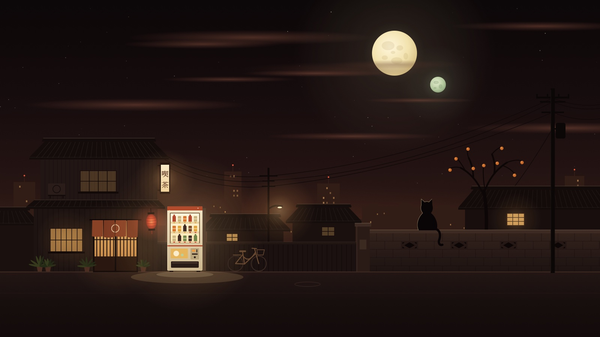

# Two moons

A warm night theme for Claude Code in the Claude desktop and mobile apps, in homage to Haruki Murakami.



*The background scene as a still frame. In the app it moves slowly, behind frosted panels.*

Behind the conversation: a quiet Tokyo backstreet under two moons, one pale gold and one small and green. A coffee house with a 喫茶 sign, a red paper lantern and a noren curtain; a glowing vending machine; a cat on a block wall looking up at the sky. Motion is slow and calm, and stops when the system's reduced-motion setting is on.

The app's own colours change to match: dark umber panels, warm cream text and a lamp-amber accent. The theme is dark mode only.

All artwork is original and drawn in SVG. It uses no book-cover imagery or other copyrighted art.

## Install

At the prompt of a Claude Code terminal session:

```
/plugin install two-moons --marketplace alazovski/two-moons
```

Answer `y` to add the marketplace, then pick a scope (user scope applies it to every session).

From a shell:

```
claude plugin install two-moons --marketplace alazovski/two-moons
```

In the Claude desktop app: click + next to the prompt box, then Plugins, Add marketplace with `alazovski/two-moons`, then Add plugin.

## Where it shows

The scene and colours draw in Code tab sessions in the Claude desktop and mobile apps. Terminals and editors don't draw themes.
